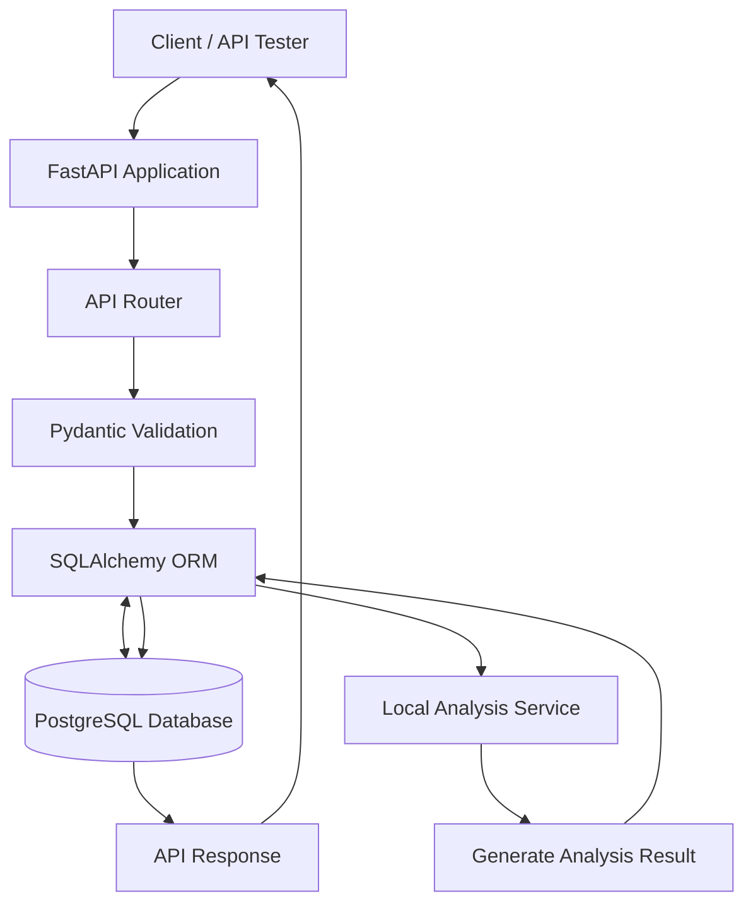

# VoxCare AI

### AI-Powered Voice Process Quality & Productivity Assistant

VoxCare AI is a Python-based backend application designed to analyze voice-process call transcripts and provide useful insights into customer interactions.

The application currently uses a rule-based analysis engine to identify customer intent, detect sentiment, generate short summaries, and recommend whether follow-up is required.

The project is developed using FastAPI, PostgreSQL, SQLAlchemy, and Python.

---

## 1. Problem Statement

Voice-process teams handle a large number of customer conversations every day. Reviewing these conversations manually can take considerable time and make it difficult to identify recurring customer concerns, unresolved issues, and opportunities to improve service quality.

Without a structured analysis process, supervisors may find it challenging to monitor customer sentiment, understand customer intent, and identify calls that require follow-up.

## 2. Project Overview

VoxCare AI aims to simplify the review of voice-process conversations by analyzing call transcripts and presenting useful insights.

The current backend accepts text-based call transcripts, stores call records in a PostgreSQL database, and applies a rule-based analysis engine to:

- Generate short call summaries.
- Identify customer intent.
- Classify customer sentiment as positive, negative, or neutral.
- Determine whether follow-up may be required.
- Maintain analysis history for each call.

The application is being developed as a learning and portfolio project using Python and modern backend technologies.

## 3. Key Features

### 3.1 Call Transcript Management

- Create and store call records.
- Maintain call reference and agent information.
- Retrieve individual call records.
- View the list of stored calls.
- Prevent duplicate call references.

### 3.2 Rule-Based Call Analysis

- Generate short summaries from call transcripts.
- Identify customer intent using predefined keywords.
- Classify sentiment as positive, negative, or neutral.
- Determine whether a call may require follow-up.

### 3.3 Analysis History

- Store analysis results in PostgreSQL.
- Retrieve all analyses associated with a call.
- Display the latest analysis alongside call details.
- Maintain multiple analysis records for each call.
- Retrieve analysis history from newest to oldest.

### 3.4 REST API Development

- Build RESTful APIs using FastAPI.
- Validate request and response data using Pydantic.
- Handle errors such as missing calls and duplicate references.
- Explore and test endpoints through Swagger UI.

### 3.5 Database Integration

- Use PostgreSQL for persistent data storage.
- Use SQLAlchemy ORM for database operations.
- Maintain relationships between call records and analysis records.

### 3.6 Automated Testing

- Write backend tests using Pytest.
- Test API endpoints using FastAPI TestClient.
- Use an isolated SQLite database for automated tests.

## 4. Technology Stack

### Backend

- Python 3.12 – Core programming language.
- FastAPI – Framework for building REST APIs.
- Pydantic – Request and response data validation.
- SQLAlchemy – Object-relational mapping (ORM).

### Database

- PostgreSQL 16 – Relational database for persistent storage.
- SQLite – Lightweight database used for automated tests.

### Testing

- Pytest – Backend automated testing framework.
- HTTPX – HTTP client used by FastAPI TestClient.

### Development Tools

- Visual Studio Code – Code editor.
- Docker Desktop – Running PostgreSQL in a container.
- Git – Version control.
- GitHub – Source code hosting.
- Swagger UI – Interactive API documentation and testing.

## 5. System Architecture

VoxCare AI follows a layered backend architecture. Each component has a specific responsibility, making the application easier to maintain, test, and extend.

### Architecture Flow

1. The client sends an HTTP request containing call transcript details.
2. FastAPI receives the request through the API router.
3. Pydantic validates the incoming request data.
4. The API router executes the required operation.
5. SQLAlchemy communicates with PostgreSQL to retrieve or store call records.
6. For analysis requests, the local analysis service processes the retrieved transcript using predefined rules.
7. SQLAlchemy stores the generated analysis result in PostgreSQL.
8. FastAPI returns the appropriate response to the client.

### Architecture Diagram



### Architecture Components

- **API Layer:** Handles incoming HTTP requests and responses.
- **Validation Layer:** Validates request and response data using Pydantic.
- **Service Layer:** Contains transcript analysis and business logic.
- **Database Layer:** Manages database connections and queries through SQLAlchemy.
- **Database:** Stores call records and analysis history in PostgreSQL.

## 6. Database Design

VoxCare AI uses PostgreSQL as its relational database to store call records and their corresponding analysis results.

The database currently contains two main tables.

### 6.1 Calls Table

The `calls` table stores information about customer conversations.

| Column | Data Type | Description |
|---|---|---|
| id | Integer | Primary key |
| call_reference | String | Unique call reference |
| agent_name | String | Agent name |
| transcript | Text | Customer call transcript |
| status | String | Call processing status |
| created_at | DateTime | Record creation timestamp |

### 6.2 Call Analyses Table

The `call_analyses` table stores the results generated by the local analysis service.

| Column | Data Type | Description |
|---|---|---|
| id | Integer | Primary key |
| call_id | Integer | Foreign key referencing calls.id |
| summary | Text | Short call summary |
| customer_intent | String | Detected customer intent |
| sentiment | String | Customer sentiment |
| follow_up_required | Boolean | Indicates whether follow-up is required |
| analysis_method | String | Analysis method used |
| created_at | DateTime | Analysis creation timestamp |

### 6.3 Database Relationship

The database follows a one-to-many relationship:

- One call can have multiple analysis records.
- Each analysis record belongs to one call.
- The `call_id` column connects the `call_analyses` table to the `calls` table.
- A foreign key constraint maintains referential integrity.
- Analysis records are retrieved in descending creation order.

### Database Technologies

- PostgreSQL 16
- SQLAlchemy ORM
- Relational database design
- Primary keys and foreign keys

## 7. API Documentation

VoxCare AI provides RESTful APIs built using FastAPI to manage call transcripts and analyze customer conversations.

### 7.1 Base URL

```text
http://127.0.0.1:8000
```

### 7.2 API Endpoints

| Method | Endpoint | Description |
|---|---|---|
| GET | `/` | Check whether the backend is running |
| GET | `/health` | Check application health |
| POST | `/api/v1/calls/` | Create a new call record |
| GET | `/api/v1/calls/` | Retrieve all call records |
| GET | `/api/v1/calls/{call_id}` | Retrieve a specific call |
| POST | `/api/v1/calls/{call_id}/analyze` | Analyze a call transcript |
| GET | `/api/v1/calls/{call_id}/details` | Retrieve call details with the latest analysis |
| GET | `/api/v1/calls/{call_id}/analyses` | Retrieve complete analysis history |

### 7.3 Example: Create a Call

**HTTP Method:** POST

**Endpoint:**

```text
/api/v1/calls/
```

**Request Body:**

```json
{
  "call_reference": "VC-1001",
  "agent_name": "Agent_01",
  "transcript": "Customer called to check the status of an appointment. The agent verified the details and explained the next steps."
}
```

The API creates a new call record and stores it in PostgreSQL.

The response contains the created call's ID, reference, agent name, transcript, status, and creation timestamp.

### 7.4 Example: Analyze a Call

**HTTP Method:** POST

**Endpoint:**

```text
/api/v1/calls/1/analyze
```

The API retrieves the specified call transcript, processes it using the local rule-based analysis engine, and stores the generated analysis result in PostgreSQL.

### 7.5 Example: Retrieve Call Details

**HTTP Method:** GET

**Endpoint:**

```text
/api/v1/calls/1/details
```

Returns the call information together with its latest available analysis, if one exists.

### 7.6 Example: Retrieve Analysis History

**HTTP Method:** GET

**Endpoint:**

```text
/api/v1/calls/1/analyses
```

Returns all analysis records associated with the specified call, ordered from newest to oldest.

### 7.7 Interactive API Documentation

FastAPI automatically generates interactive API documentation using Swagger UI.

After starting the backend, open:

```text
http://127.0.0.1:8000/docs
```

Swagger UI allows developers to explore API endpoints, submit requests, and inspect responses.

---

## Current Implementation Notes

- The analysis engine currently uses predefined keyword-matching rules.
- The summary generator extracts the first two sentences.
- Intent detection uses predefined keyword categories.
- Sentiment classification uses positive and negative keyword matching.
- Follow-up recommendations depend on detected sentiment and intent.
- LLM-based analysis, audio processing, and frontend development are not yet implemented.

## Project Status

The backend currently supports:

- Call transcript management.
- Rule-based call analysis.
- PostgreSQL database integration.
- Analysis history.
- REST API development.
- Automated backend testing.